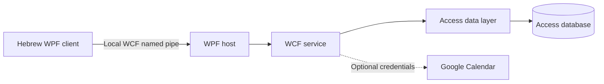

# LivingRoom

[](https://github.com/OfirMana/LivingRoom-/actions/workflows/build.yml)

A Hebrew Windows desktop application for organizing family life: household tasks,
shopping lists, family members, polls, and an optional Google Calendar integration.
Created by Ofir Mana as a 2025 software engineering graduation project.

## Engineering highlights

- **Five-project architecture:** separate models, Access data layer, WCF service,
  desktop host, and Hebrew WPF client.
- **Atomic writes:** failed operations roll back related changes, including
  linked login/member creation.
- **Isolated change queues:** each repository instance owns its pending writes.
- **Parameterized core writes:** typed text, dates, flags, and IDs in the family,
  member, task, shopping, and poll flows.
- **Verified delivery:** 31 database-backed integration checks, a Windows CI build,
  and a packaged app with a checksum.

[Engineering decisions and tradeoffs](docs/ENGINEERING.md) ·
[Verification details](docs/VERIFICATION.md) ·
[מדריך הפעלה בעברית](docs/QUICKSTART.he.md)

## Try the Windows app

**אין צורך ב־Visual Studio כדי להפעיל את החבילה המוכנה.**

[מדריך הפעלה קצר בעברית](docs/QUICKSTART.he.md)

1. Open [Actions → Windows build](https://github.com/OfirMana/LivingRoom-/actions/workflows/build.yml)
   and choose the latest successful run.
2. Download the `LivingRoom-Windows-x64` artifact. Extract that download, then extract
   the application ZIP inside it completely into a writable folder.
3. Open `Start-LivingRoom.cmd`. Keep both the host and client windows open.
4. Register a new family and member. Choose the manager checkbox for the first member.

The package starts with an empty family database and an existing city lookup.
See the prerequisites below if a runtime component is missing. A checksum is
included next to the ZIP. GitHub requires access to this private repository to
download its build artifacts.

| Feature | What you can do |
| --- | --- |
| Family members | Register, join a family, and manage member details |
| Household tasks | Add tasks with deadlines and mark them complete |
| Shopping | Maintain a shared list and mark items as purchased |
| Family polls | Create options and cast votes |
| Calendar | Connect a separately configured Google Calendar account |

## Architecture

| Project | Responsibility |
| --- | --- |
| `Model` | Data contracts and family, task, shopping, and poll entities |
| `viewModel` | Access data access through ACE/OLE DB |
| `WcfServiceLibrary1` | WCF service and optional Google Calendar integration |
| `Host` | Local WPF service host |
| `ofirManaFamily` | Hebrew WPF client with WebView2 calendar display |



The solution targets .NET Framework 4.7.2 and Windows x64.

## Requirements

- Windows 10/11 x64 with .NET Framework 4.7.2 or a compatible later 4.x runtime.
- Microsoft Access Database Engine (ACE 16.0), **64-bit**. Microsoft Access or
  Microsoft 365 Access Runtime provides the required OLE DB provider.
- Microsoft Edge WebView2 Runtime for the calendar page.
- To build: Visual Studio 2022 or Build Tools 2022 with **.NET desktop build tools**,
  .NET Framework 4.7.2 targeting pack, MSBuild, and NuGet restore support.

## Build and run

From PowerShell in the repository root:

```powershell
.\scripts\Build-LivingRoom.ps1
.\scripts\Start-LivingRoom.ps1
```

The launcher opens the host first, then the client. Keep the host window open.
The first run creates `.local/LivingRoom.accdb` from a **sanitized database template**.
There are no original families or login accounts in that template. Register a
family, create its first member, and select the manager checkbox for that member.
Your working database is ignored by Git and is not overwritten by rebuilding.

An alternative verified build uses a Windows .NET 8 SDK and the official
`Microsoft.NETFramework.ReferenceAssemblies.net472` 1.0.3 NuGet package:

```powershell
.\scripts\Build-LivingRoom.ps1 -DotNetPath 'D:\Tools\dotnet\dotnet.exe' -ReferenceAssembliesPath 'D:\Tools\net472\build'
```

For that alternative, first restore each `packages.config` using `nuget.exe restore
<path-to-packages.config> -PackagesDirectory packages`. The legacy dependencies
remain pinned in those files. No full Visual Studio IDE is required.

אם אין צורך לשנות קוד, אפשר להשתמש בחבילת ההרצה המקומית שהוכנה לצד הפרויקט.
בהפעלה הראשונה יוצרים משפחה ומשתמש חדש; נתוני המשפחה המקוריים אינם כלולים במסד ההדגמה.

### Existing private database

Back up your database before using it. To run with your own copy:

```powershell
.\scripts\Start-LivingRoom.ps1 -DatabasePath 'D:\PrivateBackup\FamilyProjectOfir.accdb'
```

The service also supports the process environment variable `LIVINGROOM_DATABASE_PATH`.
If it is absent, it uses `DATA/FamilyProjectOfir.accdb` beside the running executable.

### Local service connection

The desktop client and host use WCF named pipes at
`net.pipe://localhost/LivingRoom/Service1/`. This local connection requires no HTTP
URL reservation, administrator launch, or network port. The launcher waits for a
host readiness signal before opening the client. Closing the host releases it.

### Optional Google Calendar

The local features work without a Google key. Opening the calendar page without
configuration displays a message instead of crashing the client.

For calendar integration, configure your own Google Cloud service account and
Calendar API access, then supply its JSON file with `-GoogleCredentialsPath`, or
set `GOOGLE_APPLICATION_CREDENTIALS` before launching the host. Never commit that
file. The original key is deliberately excluded from this repository.

The integration **does not automatically grant public access to family
calendars**. The embedded calendar view may require the calendar owner
to configure appropriate viewer access and a signed-in browser session. Live
Google operations and that embedded view have not been verified in this version.

## Verification

After building, with ACE 16.0 x64 installed:

```powershell
.\scripts\Test-LivingRoom.ps1
```

The test creates a disposable database copy. It covers linked family/user creation,
valid and invalid login, task completion, shopping purchases, polls/options/votes,
deletion, missing Google configuration, WCF serialization, queue isolation, and
rollback of a partially failed operation. It never modifies
the database template or the original private database.

See [verification details](docs/VERIFICATION.md) and [source provenance](docs/PROVENANCE.md).

## Scope and limitations

LivingRoom is an educational desktop application. It is not a production or
internet-facing service. The legacy
authentication stores passwords in the Access database and the service does not
enforce a complete authorization boundary. Use disposable local demo credentials;
authentication, authorization, and the remaining legacy SQL builders need a
separate security redesign before real deployment.

Original archives, private database contents, Google keys, and the unredacted
project book are intentionally kept outside the Git repository.
